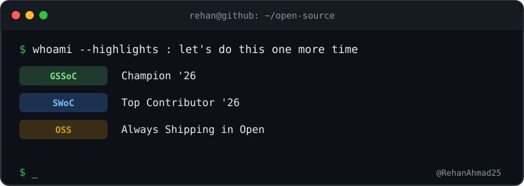

<pre>
██████╗ ███████╗██╗  ██╗ █████╗ ███╗   ██╗     █████╗ ██╗  ██╗███╗   ███╗ █████╗ ██████╗ 
██╔══██╗██╔════╝██║  ██║██╔══██╗████╗  ██║    ██╔══██╗██║  ██║████╗ ████║██╔══██╗██╔══██╗
██████╔╝█████╗  ███████║███████║██╔██╗ ██║    ███████║███████║██╔████╔██║███████║██║  ██║
██╔══██╗██╔══╝  ██╔══██║██╔══██║██║╚██╗██║    ██╔══██║██╔══██║██║╚██╔╝██║██╔══██║██║  ██║
██║  ██║███████╗██║  ██║██║  ██║██║ ╚████║    ██║  ██║██║  ██║██║ ╚═╝ ██║██║  ██║██████╔╝
╚═╝  ╚═╝╚══════╝╚═╝  ╚═╝╚═╝  ╚═╝╚═╝  ╚═══╝    ╚═╝  ╚═╝╚═╝  ╚═╝╚═╝     ╚═╝╚═╝  ╚═════╝
</pre>

